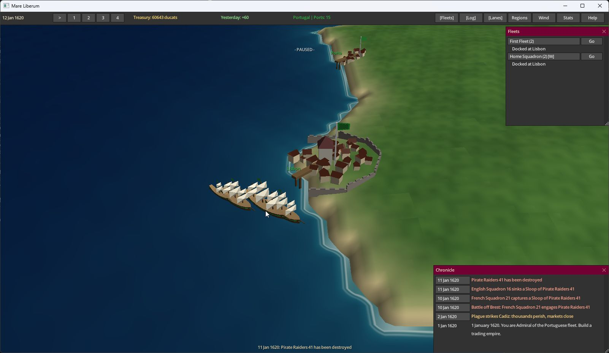

# Mare Liberum

3D pomorska strategija u stvarnom vremenu, smještena u 1620. godinu.
Napisana u C-u na v3 engineu, kao osnova za daljnji razvoj.

Upravljaj trgovačkim i ratnim flotama, razvijaj luke, osnivaj kolonije i poveži
proizvodnju zaleđa s prekomorskom trgovinom. Karta obuhvaća Europu, Amerike i
dijelove Afrike. Zumiranje povezuje 3D svijet sa strateškom kartom.



## Pokretanje na Windowsu

Za izgradnju treba Visual Studio 2022 s komponentom **Desktop development with C++**
i CMake. Pokreni `Play.bat`: pri prvom pokretanju izgradi igru, zatim je otvori.
Nakon promjena koda pokreni `Build.bat`, a za testove `Build.bat test`.
Izvršna datoteka je `build/Release/mare.exe`.

```powershell
cmake -S game -B build
cmake --build build --config Release --parallel
ctest --test-dir build -C Release --output-on-failure
.\build\Release\mare.exe
```

Na Linuxu i macOS-u slijedi [priručnik igre](game/README.md).
GitHub Actions gradi i testira sve tri platforme; Windows build preuzima se među
artefaktima uspješnog workflowa.

## Kontrole

| Tipka / miš | Radnja |
|---|---|
| WASD / strelice | Pomicanje kamere |
| Kotačić miša | Zumiranje |
| M | Prebacivanje 3D / strateška karta |
| Lijevi klik | Odabir luke ili flote |
| Desni klik s odabranom flotom | Plovidba, pristajanje, napad ili kolonizacija |
| Space / 1–4 | Pauza / brzina simulacije |
| F5 / F9 | Spremanje / učitavanje |
| F1 / F3 | Pomoć / razvojna nadzorna ploča |

## Uključene funkcije

- Dinamička ponuda, potražnja, cijene, carine i automatske trgovačke rute.
- Pomorske bitke, gusari, opsade, blokade, diplomacija i povijesni događaji.
- Razvoj luka, gradnja brodova, proizvodnja, prosperitet i migracije.
- Slobodno osnivanje kolonija, spajanje naselja, kulture i pobune.
- Zaleđa luka, ruralna proizvodnja, rudnici, razvoj regija i 17 vrsta robe.
- 3D teren i more, modeli gradova i brodova, LOD te strateški prikaz regija.
- Spremanje igre, dijagnostički zapisi, metrike i testovi simulacije.

Ovo je razvojna verzija 0.7.1. Dodatne ideje iz transkripta koje još nisu
implementirane nalaze se u [planu razvoja](docs/ROADMAP.md).

## Nastavak razvoja

- [Uvod za developere](game/docs/ONBOARDING.md)
- [Popis funkcija](game/docs/FEATURES.md)
- [Poznata ograničenja](game/docs/KNOWN_ISSUES.md)
- [Zapis obnove i provjere](docs/RECOVERY.md)
- [Povijest promjena](game/docs/CHANGELOG.md)
- [Dizajn zaleđa](game/docs/DESIGN_HINTERLAND.md)

Kod igre je u `game/src`, testovi u `game/tests`, a priloženi v3 engine u korijenu
i `ext`. Izvorne licence enginea su u [docs/LICENSE](docs/LICENSE), uz licence
pojedinačnih biblioteka u `ext`. Privatni transkript i privremeni materijali obnove
nisu dio repozitorija.
